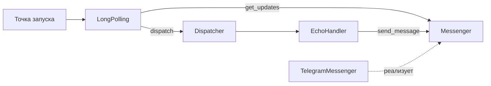

# unn-2026-fatekhov

Учебный эхо-бот для Telegram на Python 3.12+. На входящее текстовое сообщение
отвечает тем же текстом в тот же чат. Остальные типы сообщений игнорирует.

Бот работает без aiogram и сторонних runtime-зависимостей: запросы к Telegram
Bot API выполняются через стандартную библиотеку `urllib`.

## Как устроен бот



- `echo_bot/__main__.py` — точка запуска и соединение компонентов.
- `echo_bot/config.py` — конфигурация из переменных окружения.
- `echo_bot/messenger.py` — интерфейс `Messenger` для получения обновлений и отправки сообщений.
- `echo_bot/telegram.py` — реализация интерфейса для Telegram Bot API.
- `echo_bot/polling.py` — цикл long polling, управление offset и повторы при временных ошибках.
- `echo_bot/dispatcher.py` — передача входящих сообщений обработчику.
- `echo_bot/handlers.py` — отправка исходного текста в исходный чат.

Polling и обработчик зависят от интерфейса `Messenger`, а конкретный Telegram-клиент
подключается в точке запуска. В тестах вместо него используется фиктивный транспорт.

## Переменные окружения

| Переменная | Обязательная | Описание |
| --- | --- | --- |
| `TELEGRAM_TOKEN` | Да | Токен Telegram-бота |
| `TELEGRAM_BASE_URL` | Да | Адрес Bot API, например `https://api.telegram.org` |

Клиент использует указанный базовый адрес, добавляя `/bot<token>/<method>`.
Файл `.env` при локальном запуске автоматически не загружается.

## Запуск

### PowerShell

```powershell
python -m venv .venv
.\.venv\Scripts\python.exe -m pip install -e ".[dev]"
$env:TELEGRAM_TOKEN = "ваш-токен"
$env:TELEGRAM_BASE_URL = "https://api.telegram.org"
.\.venv\Scripts\python.exe -m echo_bot
```

### Linux / macOS

```sh
python3 -m venv .venv
. .venv/bin/activate
make install
export TELEGRAM_TOKEN='ваш-токен'
export TELEGRAM_BASE_URL='https://api.telegram.org'
make run
```

Также доступен запуск `python main.py`. Остановка — `Ctrl+C`.

## Проверки

```sh
make check         # форматирование, линтер, типы и тесты
make test          # тесты pytest
make format-check  # проверка форматирования Ruff
make format        # автоформатирование Ruff
make lint          # проверка линтера Ruff
make lint-fix      # исправления линтера Ruff
make typecheck     # строгая проверка типов mypy
```

В PowerShell Python виртуального окружения можно указать явно:

```powershell
make PYTHON=.venv/Scripts/python.exe check
```

Тесты проверяют обработчик, dispatcher, long polling, конфигурацию и Telegram-клиент.
Интеграционный тест выполняет полный путь сообщения через локальный HTTP-сервер.

## Docker

Готовый образ опубликован в GitHub Container Registry:

```sh
docker pull ghcr.io/kamil-fatekhov/unn-2026-fatekhov:latest
docker run --rm --env-file .env ghcr.io/kamil-fatekhov/unn-2026-fatekhov:latest
```

Для запуска создайте `.env` по образцу `.env.example` и укажите значения переменных.

Локальная сборка и запуск:

```sh
make docker-build
docker run --rm --env-file .env unn-2026-fatekhov:local
```

Контейнер работает от непривилегированного пользователя. Конфигурация передаётся
при запуске; файлы с секретами исключены из Git и контекста Docker-сборки.

## CI/CD

GitHub Actions проверяет форматирование Ruff, линтер, типы mypy, тесты и сборку
Docker-образа для pull request и изменений в `master`. После успешных проверок
при push в `master` образ публикуется в GHCR с тегами `latest` и SHA коммита.
